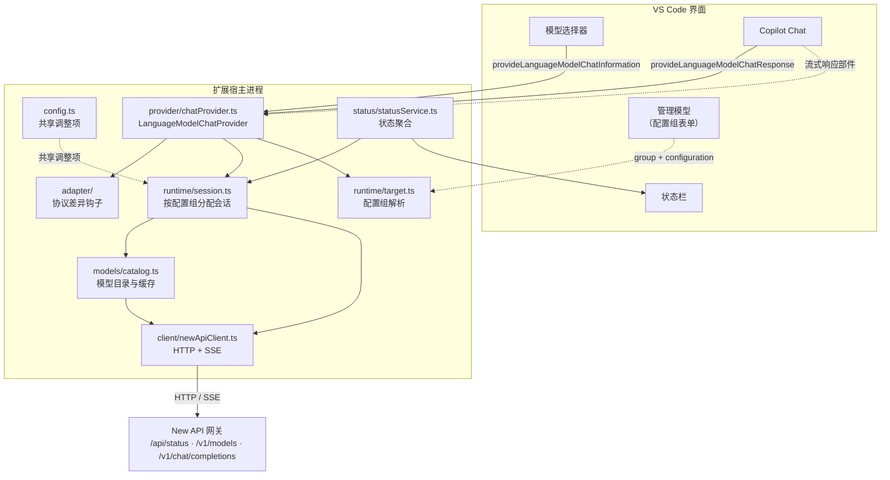
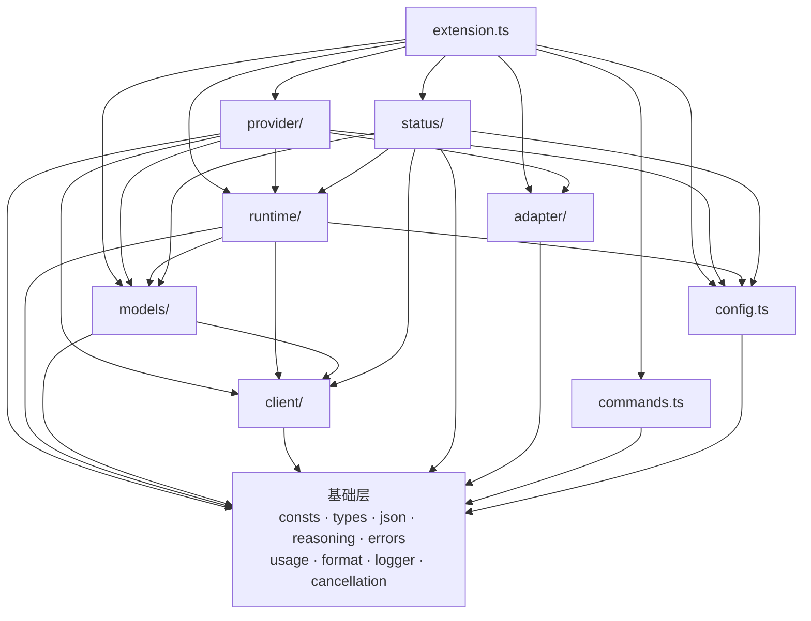

# 架构说明

面向要修改这个代码库的人：**代码在哪**、**为什么这么分层**、**改动某类需求要动哪里**。
使用者的功能与配置说明见 [`README.zh-CN.md`](../README.zh-CN.md)（英文版见 [`README.md`](../README.md)）；
通用层与厂商适配的设计依据见 [`PROVIDER-DESIGN.md`](./PROVIDER-DESIGN.md)。

## 1. 这个扩展在做什么

把 [New API](https://github.com/QuantumNous/new-api)（OpenAI 兼容网关）里的模型，作为
**自带密钥（BYOK）**的语言模型供应商注册给 GitHub Copilot Chat，实现 VS Code 的
`LanguageModelChatProvider`（发现模型、处理请求、估算 token）。难点不在接口本身，而在接口两侧的落差：

| 落差 | 具体表现 |
| --- | --- |
| **模型元数据缺失** | `/v1/models` 通常只返回 `id`，而 VS Code 需要上下文窗口、输出上限、图片/工具能力 |
| **消息模型不同** | VS Code 只有 User / Assistant 两种角色、工具结果挂在用户消息里；OpenAI 兼容协议有 `system` 与独立的 `role: 'tool'` |
| **配置来自 VS Code** | 站点与密钥由 VS Code 的 provider 配置组下发，同一供应商可以有多个组 |
| **上游实现不一致** | 思考字段名、`max_tokens` 与 `max_completion_tokens`、推理模型不接受 `temperature` 等 |

代码结构就是分别处理这四个落差：`models/` 补元数据，`provider/messages.ts` 转消息，
`runtime/target.ts` 解析配置组，`adapter/` 吸收上游差异。

## 2. 数据流



一次请求经过的环节：

1. **发现模型**：从 `options` 解析配置组 → 会话 → `catalog`（缓存或 `/v1/models`）→ `models/`
   整合成 `ModelConfig` → 映射成 VS Code 的模型信息。响应阶段靠模型信息里挂的目标指纹找回同一个会话。
2. **处理请求**：`request.ts` 转换消息、工具与思考参数 → 适配器改写 → `headers.ts` 解析请求头 → 单次发往网关 →
   流式 chunk 翻成中立部件 → 上报给宿主。
3. **收尾**：回传用量部件、留下思考内容回放标记，然后写状态栏与日志。

几件容易看漏的事：

- **消息会一变多**：一条 VS Code 消息可能拆成 `assistant(tool_calls)` + 若干 `tool` 消息，
  顺序错了上游直接 400（见 §8）。
- **正文是边收边发的**：`progress.report()` 在收流的循环里调用，逐字输出不是等流结束才出现。
- **请求被强制带上 `stream: true`、`stream_options.include_usage` 与 `max_tokens`**：用量只在最后一个
  chunk 里回来；输出上限必须显式发出去，否则由各渠道的默认值决定（见 §12）。
- **工具调用在收尾时才上报**：参数分片到达，中途无法解析，因此统一在 `StreamTranslator.flush()` 里上报
  （上游给出 `finish_reason` 时提前上报）——这就是工具部件在时序上晚于所有正文片段的原因。
- **聊天请求只发送一次**：HTTP 拒绝、网络失败与断流都直接报错，不自动删除字段或重放请求。

关键判定点（细节见各层小节）：

| 判定 | 落点 | 行为 |
| --- | --- | --- |
| 找不到模型所属的会话 | `chatProvider.ts` | 抛错提示在模型选择器中重新选择（配置组已变更） |
| 转换后没有可发送的消息 | `request.ts` | 抛错，不发请求 |
| 用户取消（token 已取消，或 `isAbortError`） | `chatProvider.ts` | 静默返回，不算失败 |
| 客户端被退役/释放（配置变更、扩展停用） | `chatProvider.ts` | 照常报错（`disposed` 不是用户取消） |
| 模型具备思考能力且属于 DeepSeek / GLM / Kimi(K2.x) | `adapter/<supplier>/` | 写入原生思考开关（`thinking` 或 `enable_thinking`） |
| 辅助请求（起标题、提交信息等） | `adapter/<supplier>/` | DeepSeek 保留所选强度；Kimi K2.x / 可关闭的 GLM 使用各自关闭策略 |
| 模型不具备思考能力 | `adapter/<supplier>/` | 不写原生开关，只清掉 `reasoning_effort` |
| 数据表能力位说「不接受采样参数」 | `adapter/capabilityAdapter.ts` | 按能力位改写请求（数据驱动，不写模型名正则） |
| HTTP 非 2xx | `client/http.ts` | `HttpError`，按 `isAuthError` / `isNotFound` / `isRetryable` 分流 |
| 模型发现与站点状态的可重试错误 | `client/http.ts` | `Retry-After` 优先，否则指数退避 + 抖动；聊天 POST 禁用重试 |
| `Retry-After` 超过 30 秒 | `client/http.ts` | 不重试，把带等待时间的 429 直接报出来 |
| `content-type` 不是 SSE | `client/newApiClient.ts` | 降级为单块 JSON |
| 静默超时（长时间没有新字节） | `client/sse.ts` | `SseIdleTimeoutError`，与用户取消区分 |
| 流量正常结束但缺 `[DONE]` 与 `finish_reason` | `client/newApiClient.ts` | `SseTruncatedError` |
| 流被掐断或 HTTP 拒绝 | `provider/streamFlow.ts` | 直接传播错误，未完成工具不再冲刷 |
| 响应正常结束且带用量 | `provider/chatProvider.ts` | 回传 `usage` 数据部件 |
| chunk 带 `error` 字段 | `provider/stream.ts` | 视为失败抛出（上游会把错误塞进 200 响应） |
| 工具调用缺少函数名 | `provider/stream.ts` | 记警告并跳过 |
| 工具分片不带 `index` | `provider/stream.ts` | 按有无 `id` 判断是否开新槽 |
| 工具参数不是合法 JSON | `provider/stream.ts` | 先直解，再剥 Markdown 围栏；正常结束退化为 `{}` |
| `finish_reason === 'length'` | `provider/stream.ts` | 记警告（响应被截断） |
| 其它错误 | `chatProvider.ts` | `toLanguageModelError` 把面向用户的消息交给 VS Code |

## 3. 代码地图

| 文件 | 职责 |
| --- | --- |
| `extension.ts` | 激活与装配。只做接线，读它能看清整体数据流 |
| `commands.ts` | 命令实现（测试连接 / 刷新模型 / 打开设置 / 重置用量）与「刷新后通知宿主」 |
| **基础层（各层都可依赖）** | |
| `consts.ts` | 命令 ID、端点、默认值、思考强度键名、用量部件 MIME、运行时版本 |
| `config.ts` | 共享调整项（缓存与兜底值、请求参数、状态栏、日志级别）的读取与校验；变更影响面分类 |
| `types.ts` | New API / OpenAI 兼容（DeepSeek 风格）数据结构 |
| `json.ts` | 安全解析、类型收窄、按键取候选值 |
| `reasoning.ts` | 思维链字段名的读写（唯一知道各家字段名的地方） |
| `errors.ts` | 网络错误码 → 分类 → 人话，以及日志用的错误链渲染 |
| `usage.ts` | 用量的读出（缓存命中、思维链 token、各网关字段名）与回传 Copilot 的载荷 |
| `format.ts` | token / 相对时间格式化、Markdown 转义：展示文案的唯一出口 |
| `logger.ts` | `LogOutputChannel` + 级别闸门 + 密钥脱敏 + 带上 `cause` 链的错误格式化 |
| `cancellation.ts` | `CancellationToken` → `AbortSignal` 桥接 |
| **`client/`** 与 New API 交互（只依赖基础层） | |
| `http.ts` | 超时、重试退避、信号合并、错误分类（`HttpError` / `TransportError`）；优雅退役 |
| `sse.ts` | SSE 解析与收尾信息、静默超时、非 SSE 降级读取、截断判定 |
| `newApiClient.ts` | 端点封装、模型列表解析、错误描述与失败建议 |
| **`models/`** 模型信息整合（只依赖基础层） | |
| `dataset.ts` | 模型数据表（`data/openrouter-models.json`）：校验、索引与查找 |
| `remoteHints.ts` | 远端字段提取：唯一知道各家网关字段名的地方 |
| `limits.ts` | 窗口/输出/输入的一致性校正、显著差异判定 |
| `modelConfig.ts` | 按优先级合并三路来源，记录来源与校正说明 |
| `tooltip.ts` | 悬浮窗 Markdown（身份行 + 规模与能力逐项一行、键值分列） |
| `catalog.ts` | 拉取编排、缓存、并发合并、失败降级；快照没变就不触发事件 |
| **`runtime/`** 连接目标与会话 | |
| `target.ts` | 解析 VS Code 下发的配置组 + 配置指纹 |
| `session.ts` | 按「会话签名」缓存 client + catalog；丢缓存与优雅退役是两条不同的路 |
| **`provider/`** 与 Copilot 交互 | |
| `chatProvider.ts` | 实现 `LanguageModelChatProvider`：模型发现、请求编排、token 估算与错误交还 |
| `request.ts` | 一次性准备消息、工具、输出上限、采样与思考参数，并执行协议适配 |
| `headers.ts` | 自定义请求头的 `${conversationId}` 模板解析；同一次调用共享一个 ID |
| `modelConfiguration.ts` | 模型级配置（思考强度）：schema 生成、取值解析、写进请求体 |
| `messages.ts` | VS Code ⇄ OpenAI 兼容的消息转换（含思考内容回填） |
| `stream.ts` | 流式 chunk → 中立响应部件的翻译；不依赖 `vscode` |
| `streamFlow.ts` | 单次流消费、取消检查、用量回传；中立部件 → 宿主部件 |
| `tokenizer.ts` | token 估算（宁可高估，按真实用量校准比例） |
| `thinking.ts` | 思考内容部件的探测、构造与读取（宿主提供时才存在） |
| `replay.ts` | 思考内容的回放标记：随响应留下、下次请求读回 |
| `toolFlow.ts` | 工具组预激活（`activate_*`）与预激活控制流的过滤 |
| `preflight.ts` | 工具组预激活的宿主侧；独立于 `toolFlow.ts` 是为了让后者不依赖 `vscode` |
| **`adapter/`** 差异出口 | |
| `adapter.ts` / `registry.ts` / `requestKind.ts` | 框架层：钩子接口与上下文、注册与「取全部命中项」、适配链执行；请求种类识别（与厂商无关） |
| `capabilityAdapter.ts` / `samplingParams.ts` | 数据驱动：按 `ModelConfig` 的能力位改写请求；采样参数字段与删除逻辑的唯一实现 |
| `deepseek/` | DeepSeek：显式思考开关、关闭时去掉强度字段；自定义端点辅助请求保留配置 |
| `openai/` | OpenAI 推理模型（o 系列与 GPT-5 之后）：移除采样参数、`max_tokens` → `max_completion_tokens` |
| `qwen/` / `glm/` / `kimi/` | 厂商原生思考开关与强度字段适配；均使用共享思考回放与辅助请求判据 |
| `thinkingMode.ts` | 思考选择读取与关闭语义，供厂商与能力位适配器共享 |
| **`status/`** UI | |
| `statusService.ts` | 状态的唯一真相来源，按配置组聚合 |
| `statusBar.ts` | 状态栏渲染（悬浮提示 = 本次会话消耗 + 待处理的问题） |

## 4. 分层与依赖方向



图中的箭头是运行时依赖，也是分层检查的判定依据。约束如下：

- **`client` 只在运行时依赖基础层**：用 `AbortSignal` 而不是 `CancellationToken`，网络逻辑不绑死在 VS Code 上。
- **`models` 只处理模型元数据**：不注册命令、不自己发请求；全层是纯数据转换 + 薄薄的拉取编排。
- **`adapter` 不依赖 `config`**：适配器只看模型配置与日志，拿不到用户设置。
- **`runtime` 只管「目标是谁、它有哪些运行时对象」**：既不知道 Copilot 的协议，也不渲染界面，
  因此 `provider` 与 `status` 可以同时依赖它。
- **`provider` 不直接构造 client**：一律通过 `SessionRegistry` 拿会话，多站点隔离与配置变更时的重建只有一处实现。
- **`status` 不自己构造请求**：只调用会话上已有的能力（`catalog.getModels` 与 `client.getStatus`），
  因此状态栏与「测试连接」命令看到的数据与 provider 出自同一份缓存。它对 `provider` 没有依赖：
  需要的那点会话信息写成了结构接口（`StatusSessionSource`），会话注册表天然满足。
- **`status` 对 `models` 只有类型级依赖**（读的是 `ModelCatalogSnapshot` 的形状），拉取与整合仍归 `models`。
- **`usage.ts` / `reasoning.ts` 放在基础层**：被两侧共用，放在任一侧都会造成反向依赖。
- **`extension.ts` 不含业务逻辑**：它是唯一知道「怎么把模块拼起来」的地方，新增模块只在它里面接线。
- **约束有可执行的检查**：`npm run check-layering`（`scripts/check-layering.js`）维护一份「允许依赖宿主」的
  名单，名单外的文件一旦出现运行时 `import 'vscode'` 就失败（`import type` 不算）。
- **测试沿用同样的分层**：`src/test/` 用 Node 内置 `node:test` + esbuild 现场打包加载，纯逻辑层可直接测；
  依赖宿主的模块由 `src/test/fakes.js` 的 `vscode` 替身顶上，测试不需要扩展宿主。

## 5. 基础层

- **`consts.ts`**：只放不随用户配置变化的字面量。用户可改的值先在 `package.json` 的
  `contributes.configuration` 声明、再由 `config.ts` 读取；站点与密钥声明在
  `contributes.languageModelChatProviders[].configuration` 里，只在 `runtime/target.ts` 读取。
  `VENDOR_ID` 要与三处保持一致（贡献点、激活事件 `onLanguageModelChatProvider:<vendor>`、注册调用）；
  `runtimeInfo` 在 `activate()` 时由 `package.json` 的版本填充，避免版本漂移。
- **`config.ts`**：把 settings 收敛成内部结构，非法取值记录并回退到默认值，不抛异常。
- **`types.ts`**：以 OpenAI Chat Completions 为基准，服务端字段一律可选（网关、上游、代理层都可能裁字段），
  无法穷举的交给索引签名。
- **`json.ts`**：把「解析不可信数据」收敛到一处，不抛异常；`pick*` 系列按候选键名取值，
  兼容同一语义的多种字段名。
- **`reasoning.ts`**：思维链字段名的唯一来源（读 `reasoning_content` / `reasoning`，写回填键名），
  因此「上游换字段名」只改这一张表。这是通用容错而非供应商差异，所以不放进适配器。
- **`logger.ts`**：基于 `LogOutputChannel`。自己的级别闸门与通道级别是两回事，配得比通道更详细时
  `warnIfChannelLevelBlocks()` 会提示；`redactText` 用正则兜底脱敏，调用点忘了脱敏时密钥也不会整串落进日志。
- **`errors.ts`**：网络错误码 → 分类 → 人话，同时提供日志用的错误链渲染；日志与 `client/` 都要用，因此放基础层。
- **`cancellation.ts`**：`CancellationToken` → `AbortSignal` 的集中转换，请求结束 `dispose()` 解除监听。

## 6. `client/` —— 与 New API 交互

**超时**：非流式是整体超时；流式的 `timeoutMs` 只作为「等响应头」的上限，响应体开始到达后交给
`request.streamIdleTimeoutMs` 的静默超时。两个旋钮分开是因为合理取值差得很远——长思考的模型可能长时间
不吐字节，而把「等响应头」一起放宽会掩盖真正连不上的情况。超时与重试只在客户端级配置
（`HttpClientOptions`），聊天 POST 按次禁用重试。`createSignalGuard` 把「调用方信号 + 超时 + 客户端释放」
合并成一个 `AbortSignal` 并记录是否由超时触发，其中断理由会原样成为 `fetch` 抛出的错误。

**重试**：仅模型发现与站点状态请求可重试网络错误、超时与 `408` / `409` / `425` / `429` / `5xx`；退避指数增长 + 抖动，
并尊重 `Retry-After`。一旦开始消费响应体就不再重试（服务端可能已开始计费）。`Retry-After`
超过 30 秒不再重试。聊天 POST 显式使用 `maxRetries: 0`，响应处理层也不重发。

**取消**：`vscode.CancellationError` 的 `name` 是 `Canceled` 而不是 `AbortError`，`isAbortError` 两个都认。

**错误分类**：`TransportError` 分 `network` / `timeout` / `aborted`；`HttpError` 带 `status`、
服务端描述与 `Retry-After`，并提供 `isAuthError` / `isNotFound` / `isRetryable`。

**消息自己带建议**：连接失败时 `fetch` 的外壳只是一句 `TypeError: fetch failed`，原因在 `cause` 里、
诊断字段在它的平级属性上（`code` / `syscall` / …）。`errors.ts` 按错误码分类配一句人话，两个出口各给各的读者：

| 出口 | 形态 | 给谁 |
| --- | --- | --- |
| `getNetworkErrorMessage` | `[ENOTFOUND]（api.example.com） 域名解析失败：请确认…` | 用户 |
| `describeErrorCause` | `fetch failed ← getaddrinfo ENOTFOUND … code=ENOTFOUND` | 日志 |

码留在方括号里：它是唯一能拿去搜索比对的原始信息，认不出的码照原样展示；普通构造名
（`Error` / `TypeError`）不算码，但 `TimeoutError` / `SocketError` 这类 undici 名字有意义，照用。
原始明细（`syscall` / `errno`）只进日志，主机只取 host。因此 `describeFailureHint` 对
`kind === 'network'` 返回 `undefined`：建议已经在消息里了。

**流怎么结束**：客户端要求流必须给出 `[DONE]` 或某个 chunk 的 `finish_reason`。两者都没有但已解出过
数据块时报 `SseTruncatedError`；一个数据块都没解出来时不判定为截断（分不清「响应为空」与「格式不认识」）。

**`sse.ts` 的容错点**：按 `\n` 分帧并容忍 `\r\n`、忽略 `:` 开头的心跳注释行、处理流结束时不带结尾换行的
残留事件、单个 chunk 解析失败只记日志并跳过。非 SSE 降级路径复用同一套静默超时。

**非流式降级**：网关忽略 `stream: true` 而返回普通 JSON 时，`newApiClient` 检测 `content-type`
并把响应包装成一个等价的 chunk，让上层只处理一种形态。

**连通性由状态服务组织**：`client` 只有两个原子能力（`listModels()` / `getStatus()`，后者失败不抛异常，
因为 `/api/status` 是 New API 的自有扩展）。`StatusService` 把它们拼成「这个站点现在怎么样」，
失败时由 `describeFailureHint()` 给出可操作建议。只有一处发起探测，因此状态栏与「测试连接」命令口径一致。

## 7. `models/` —— 模型信息整合

优先级：**① 网关返回的扩展字段（remote）> ② 随包数据表按 ID 查表（dataset）> ③ 兜底默认值（default）**。
网关最清楚自己那条链路，数据表只是生成时的快照；两者显著不一致时以网关为准并写进 debug 日志，
每个字段的来源记在 `meta.provenance`。

- **模型信息里的主名是展示名**（`displayName ?? id`），`id` 单独留在 `id` 字段里用于回传请求。
- **tooltip 不写标题**（悬浮卡片自己会渲染模型名），身份行改用等宽的 `id`。
- **tooltip 一项一个段落**：卡片容器只有 300px 宽、零段落间距，用 `·` 串成一行会让折行位置取决于宽度；
  标签用全角空格补到等宽（半角空格会被 Markdown 折叠），保证取值列对齐。
- **思考能力是例外**：远端只能给出「肯定」，因此数据表先落地、网关的肯定最后覆盖，
  既不会抹掉已知能力，也不会因为表里写了 `false` 而隐藏站点声明支持的选项。

### 一致性校正（`limits.ts`）

三路来源合起来容易出现自相矛盾的数值。`reconcileLimits` 统一收敛：`maxInputTokens + maxOutputTokens
<= contextWindow`、输出上限不挤占输入空间（至少给输入留 1/4 窗口）、各项不低于下限。
每次修正都收集到 `adjustments` 里，最后由 `resolveModelConfig` 写成一条 debug 日志。

校正后的窗口还作为 `maxContextWindowTokens` 单独报给 VS Code（不在 stable typings 里，属 `chatProvider`
提案）。不报时宿主只能按 `maxInputTokens + maxOutputTokens` 兜底，而那个和只在「没有显式输入上限」时
才等于窗口。

### 远端字段提取（`remoteHints.ts`）

覆盖实际观察到的几种风格：New API / one-api 的 `context_length`、OpenRouter 的
`top_provider.max_completion_tokens` 与 `architecture.input_modalities`、vLLM 的 `max_model_len`、
通用的 `supports_vision` / `capabilities.*`。

两处保守：语义含糊的 `max_tokens` 不据此臆测上下文窗口，只当作输出上限；`supported_parameters`
里出现 `reasoning` 说明支持，但没出现不说明不支持。

### 模型数据表（`dataset.ts` + `data/openrouter-models.json`）

随包发布的 JSON，由 `npm run models:openrouter` 生成，`extension.ts` 在激活时读入，
`dataset.ts` 负责校验、建索引与查找。

- **生成产物，扩展只读**：没有「用户覆盖」设置项，也没有打开/监听数据表的命令，否则就变成两份需要
  同步的数据。不做成源码里的常量表也是同理：几百条数据持续变动，独立文件让更新数据不必改代码。
- **数据是不可信输入**：缺 `id` 或缺正数窗口/输出的条目在载入时丢弃并计数，单条坏数据不会让整张表失效。
- **匹配从精确到宽松**：先精确命中，命中不了才逐层剥厂商前缀、变体、渠道、日期后缀。
- **载入失败不沿用旧数据**：文件缺失或不是合法 JSON 时显式清空，退回「网关返回值 + 默认值」。

### 缓存与失败降级（`catalog.ts`）

- **并发合并**：短时间内的多次模型发现用一个 in-flight promise 合并成一次请求。
- **stale-while-error**：成功过就用旧数据 + 错误标记，已看到的模型不该因为网关抖动而消失。
- **失败不缓存空结果**：从未成功过时不写 snapshot，改用 10 秒退避。
- **不接入调用方的 CancellationToken**：VS Code 会在 UI 更新后立即取消该 token，接上共享请求后
  一次取消会连带取消其他调用方。

## 8. `provider/` —— 与 Copilot 交互

拆分的标准是**消费者与变化原因**：只有 `chatProvider` 一个消费者的辅助函数就地写在它末尾，
被两处以上用、或成因完全不同的才独立成模块。

| 模块 | 消费者 | 变化原因 |
| --- | --- | --- |
| `stream.ts` | `streamFlow.ts` | 上游 chunk 的形状 |
| `messages.ts` | `request.ts` | Copilot 消息模型变了 |
| `modelConfiguration.ts` | `chatProvider.ts` / `request.ts` | 模型级控件方案变了 |
| `request.ts` / `headers.ts` | `chatProvider.ts` | 请求体与请求头准备方式变了 |
| `toolFlow.ts` | `chatProvider.ts` | 预激活机制变了 |
| `streamFlow.ts` | 只有 `chatProvider.ts` | 体积已超出「就地写」的限度 |

**翻译层不认识 VS Code**：`stream.ts` 产出三种中立部件（`text` / `reasoning` / `toolCall`），
翻成宿主部件的事在 `streamFlow.ts` 的 `reportResponsePart()` 里——那是唯一边界。
最容易出错的那一层（分片归并、引用块排版、截断判定）因此不必为了碰它而启动扩展宿主。

**传输维度的锚点是 `ChatStreamSource`**：provider 只要求「能按请求吐出一串 chunk」，
并不知道它是怎么发出去的。换端点形态是替换一个实现，而不是在 provider 里加分支。

### 配置组与会话（`runtime/`）

配置完全由 VS Code 提供：`package.json` 的 `configuration` 贡献点是一份 JSON Schema，
VS Code 据此生成表单并把解析好的值随调用传进来。`createTarget` 把它归一成 `ProviderTarget`
（规范化 `baseUrl` + 明文 `apiKey` + 配置指纹 + 问题列表）。

- **`key` 是配置指纹（FNV-1a），不含明文密钥**——它会作为 Map 键并出现在日志里。
- **会话槽位是组名**：不能全局共用（否则 A 站的模型列表会串到 B 站），也不该每次新建
  （VS Code 会反复轮询）。复用判据是「会话签名」：目标指纹 + client 的构造参数
  （超时、静默超时、是否要用量、重试次数）——因此改日志级别或采样参数不会碰会话。
- **「丢模型缓存」与「重建会话」是两条不同的路**：模型设置变化只丢缓存（`invalidateCatalogs`，
  client 不动）；连接身份变化才重建，且旧会话走优雅退役（`retire()`：不再接新请求，
  等在途请求跑完再中断）。两条路都不中断在途请求。
- **响应阶段靠 `find(key)` 找回会话，找不到时不能退回默认目标**（那会把 A 站的模型拿去 B 站请求）。
- 模型信息里只挂指纹与标签，不挂目标本体——那些字段会长期留在 VS Code 的模型缓存里，
  而 `ProviderTarget` 含有明文密钥。

### 模型发现（`chatProvider.ts`）

`options.silent === true` 时绝不弹任何 UI（每次打开模型选择器都会调用一次）。
模型列表加载失败时不向外抛异常，而是返回空数组，由状态栏负责说明原因。`toModelInformation`
通过泛型把内部 `ModelConfig` 一并交给 VS Code——它会原样传回响应方法，因此响应阶段能拿到
已解析的能力与窗口。

### 把错误交还给 VS Code

`toLanguageModelError` 决定用户看到什么：清掉 `stack`（Copilot 会把堆栈一起渲染，而用户要的是原因；
原始异常已在日志里）、只在语义真正吻合时换用工厂方法（401/403 → `NoPermissions`、404 → `NotFound`），
唯一的加工是密钥脱敏。

**「取消」与「客户端退役」必须分开**：`TransportError` 的 `kind` 为 `aborted` 才是用户取消
（属于正常流程，静默返回）；`disposed` 是客户端被退役/释放（配置变更、扩展停用）——把它当成用户取消，
用户就会看到一个没有报错的半截回答。因此 `isAbortError()` 只认 `aborted`。

### 请求准备与单次发送

请求方式参考 `deepseek-v4-for-copilot`。`prepareChatRequest` 在发送前一次性生成最终消息和工具，
思考模型的默认档位与用户选择一并解析。`extraBody` 不能覆盖协议骨架字段；工具按模型能力提供，
统一使用 `tool_choice: 'auto'`，无参数工具补空对象 schema。图片只发给声明原生图片能力的模型。

`headers.ts` 按「Copilot 会话 ID → 工作区 ID → 请求关联 ID → 随机 ID」解析 `${conversationId}`，
同一次调用中的多个模板共享一个值。请求头在默认 JSON 类型与 Bearer 鉴权之后合并，大小写不敏感。

HTTP 拒绝、网络失败和流中断直接传给宿主，不根据错误内容改写字段，也不缓存修复结果。
取消后不冲刷待完成工具、不上报最终用量与回放标记。

### 模型配置：思考强度（`modelConfiguration.ts`）

provider 可以随模型信息下发 `configurationSchema`，VS Code 据此渲染模型级控件，用户选定的值随
`options.modelConfiguration` 交回。这份 schema 必须由 provider 自己声明：`chatLanguageModels.json`
里的 `supportsReasoningEffort` 换来的控件只对内置的 BYOK 供应商生效，第三方扩展一律走
「从 `configurationSchema` 合成」这条路。数据链：

```text
数据表 supportsReasoningEffort ─▶ ModelConfig.reasoningEfforts
数据表 defaultReasoningEffort  ─▶ ModelConfig.defaultReasoningEffort ─▶ schema 的 default
ModelConfig.reasoning ─▶ buildModelConfigurationSchema() ─▶ configurationSchema
用户选择 ─▶ selectReasoningEffort() ─▶ prepareChatRequest() ─▶ 请求体
```

- **属性必须带 `enum`** 才会被渲染成控件；`group: 'navigation'` 决定它落在模型卡片主控件区。
- **默认档位显式生效**：`selectReasoningEffort` 校验用户选择，`prepareChatRequest` 使用选择或数据表默认值。
  默认值必须落在 `enum` 里（这条不变量由 `resolveModelConfig` 守住）。
- **档位逐模型且没有兜底**：列表为空时不声明控件；凭空造一组值只会发出站点不认的请求。
- **选项不经翻译**：只声明 `enum`，控件里显示数据表原值。
- **取值按当前模型校验**，不在 `reasoningEfforts` 里的选择会被拒绝并记警告。
- **字段名是常量 `reasoning_effort`**，由 `prepareChatRequest` 在额外字段之后写入；需要别的叫法或嵌套形态时
  交给适配器改写。`modelOptions` 与 `modelConfiguration` 都不是稳定 typings 的字段，因此做运行时探测；
  通过扩展 API 直接调用模型的调用方写的是前者，且优先级更高。

### 消息转换（`messages.ts`）

| 概念 | VS Code | OpenAI 兼容 |
| --- | --- | --- |
| 角色 | 只有 `User` / `Assistant` | `system` / `user` / `assistant` / `tool` |
| 工具调用 | 助手消息里的 `LanguageModelToolCallPart` | 助手消息的 `tool_calls` |
| 工具结果 | 用户消息里的 `LanguageModelToolResultPart` | 独立的 `role: 'tool'` 消息，带 `tool_call_id` |
| 图片 | `LanguageModelDataPart` | `image_url`，URL 为 `data:` 形式 |

因此一个 VS Code 消息可能被拆成多条上游消息，且顺序敏感。其他细节：仅有 `tool_calls` 时
思考回填模型的 `content` 为空字符串，其余模型为 `null`；`system` 角色由「用户消息 + `name === 'system'`」启发式识别。工具结果中的图片
转换为 `image_url`，与工具文本组成多模态数组；非图片数据部件和未知对象直接忽略，避免 `cache_control`
等宿主元数据污染上下文。回放标记仍由专用路径读取。token 估算同样忽略未透传的数据部件。

### 流式翻译（`stream.ts`）

- **工具调用分片到达**：按 `index` 归并、按到达顺序拼接。上游给出 `stop` / `tool_calls` 收尾时立即上报，
  否则在 `flush` 里补报。省略 `index` 时按有没有 `id` 判断是否开新槽（退回「槽位数量」当索引
  会把参数送进没有函数名的空槽，症状是「工具被执行了但参数全空」）。解析失败时：正常结束返回空对象
  让 VS Code 报参数校验失败（模型可自我修正），流被掐断则丢弃这次调用。
- **思维链字段名由 `reasoning.ts` 统一认**，流式与非流式降级走同一个读取器。原文无论是否回显都会累积
  ——回填历史要用。
- **usage 取最后一次有效快照**：可出现在任意 chunk，`null` 不覆盖已有值；结束时只上报一次。
- 多 choice 时只取第一个（并警告）。
- **半截回答不能当作成功**：缺少正常收尾信号时直接报错，保留已经流出的内容，未完成工具不再冲刷。

### 回传用量（会话信息里的上下文窗口）

Copilot 的「上下文窗口」读响应上的 `usage`，这个值不会自己出现：它只认一个 `mimeType` 为 `'usage'`
的 `LanguageModelDataPart`。三条约定：

- **载荷必须带齐 `prompt_tokens` / `completion_tokens` / `total_tokens` 三个数字**：Copilot 用鸭子类型
  校验，缺一个整块被丢弃（`buildReportedUsage` 总是补齐）。
- **上游完全没给用量时不发**：那与 Copilot 自己的兜底值同义，发一个全 0 的载荷只会让人以为真的没消耗。
- **上报失败不能影响已经流出的回答**：兜住异常只记警告。

同一次响应里 Copilot 还会调用 `provideTokenCount` 算明细占比，分母是我们上报的 `prompt_tokens`
——两件事要一起做对。

### 思考内容：渲染与回填（`thinking.ts` / `replay.ts`）

两件事相互独立：怎么显示是外观问题，要不要回填是上游的协议要求。

- **渲染**：宿主提供 `LanguageModelThinkingPart` 时走专用部件（Copilot 渲染成可折叠思考块）；
  宿主没提供时回退到 Markdown 引用块；用户关掉 `request.includeReasoning` 时完全不输出思考内容。
  三种情况都在 `emitReasoning` 里收敛，探测按构造时定好一次处理：同一次响应里忽冷忽热地换渲染路径更糟。
   该部件按宿主实际能力探测，扩展不声明 `enabledApiProposals`。
- **回填**：DeepSeek 在思考态要求历史里的助手消息都带回 `reasoning_content`——缺席这个字段会被上游
  整次拒掉，不只是工具调用那几条，宿主自己插入的助手消息（例如读取后台终端输出的工具调用）同样算数。
  而稳定 API 不会把思考内容交还给 provider，因此响应结束时额外上报一个 `mimeType` 为
  `stateful_marker` 的 data 部件（宿主不渲染，但会留在历史里原样回传），下次构造请求时读出来填进
  `reasoning_content`。是否打开由适配器的 `echoReasoningContent` 决定；provider 只管已知的原文，
   缺口由消息转换层写入空字符串，不编造占位推理。标记格式自产自销，
  但任何一步不合预期都当作「没有标记」。

### 工具组预激活（`toolFlow.ts`）

宿主把 MCP 工具组以 `activate_<组名>` 的虚拟工具给出，模型得先「调用」它，宿主才会把组里的真实工具
展开到下一轮。`request.stabilizeToolList` 打开后（默认关闭），provider 会先结束本轮响应、逐个上报还没
激活的 `activate_*` 伪调用并附带一条「这些是系统为稳定工具列表做的预激活请求，请勿调用其它工具」的
伪结果，让宿主执行并重新发起本次请求。

- 伪调用与伪结果都带 `newapi-preflight-` 前缀，后续任何请求里都会被过滤掉（过滤是无条件的：
  用户中途关掉设置时，历史里残留的伪调用同样不能发出去）。
- 同一个用户请求里最多预激活 `MAX_PREFLIGHT_ROUNDS` 轮，到顶就报错。
- 识别范围是最后一条人类消息之后。

### Token 估算（`tokenizer.ts`）

拿不到真实分词器，只能估算：CJK 按 1 字符 ≈ 1 token、其余按 4 字符 ≈ 1 token，再加消息 / 工具 / 图片的
固定开销。偏差方向是有意选择的：宁可高估——高估会让 VS Code 更早裁剪历史，代价只是少一点上下文；
低估则会把超长请求发给上游而被拒绝。

比例由上游真实用量反推（`calibrateCharsPerToken`，指数移动平均，新观测占三成），三条口径必须与估算器一致：

- **分子包含工具定义**（`measureRequestText` 收 `messages` 与 `tools`）：Agent 模式下工具 schema
  常常占上万 token，它们算在 `prompt_tokens` 里；漏掉会把比例压到下限、估算高出数倍。
- **CJK 与非 CJK 分开数，并且是解方程而不是相除**：估算器认为
  `promptTokens ≈ cjkChars + otherChars / r`，因此由观测反解 `r = otherChars / (promptTokens − cjkChars)`。
- **比例按模型分别维护**：不同模型的分词器差别很大，共用一个比例会让估算来回摆。

没人报用量、请求为空、含原生图片、或 CJK 已经吃满用量时不校准；单个离谱的观测值会被夹在合理区间内。
比例由 provider 持有并传进纯函数——估算不偷偷改全局状态。

**思考内容每条消息只算一次**：宿主提供的思考部件与回放标记常常同时存在（装的是同一段文本），
优先用思考部件、没有才用标记。标记本身必须计入——开启 `echoReasoningContent` 的适配器会把它变成
`reasoning_content` 发给上游，不计就会在长会话里一路低估。

## 9. `adapter/` —— 协议差异的出口

不同上游对 OpenAI 协议的实现并不一致（推理模型不接受 `temperature` 且只认
`max_completion_tokens`；思考开关的字段名各异）。这些差异若全写进 provider，会散落大量
`if (model.id.startsWith(...))`，`ModelAdapter` 就是它们的唯一出口：

| 成员 | 时机 | 典型用途 |
| --- | --- | --- |
| `supports(model)` | 每次请求 | 决定这个模型交不交给本适配器 |
| `transformRequest` | 请求发出前 | 删除不支持的参数、补充网关专属字段、改写字段名 |
| `echoReasoningContent` | 每次请求 | 声明「需要把思考内容回填进历史」 |
| `AdapterContext` | 每次请求 | 模型配置、日志、已校验的思考选择（不含用户设置） |

- **适配器覆盖的是请求体侧的差异**。响应侧的形状属于传输维度，由 `ChatStreamSource` + `stream.ts`
  承接（见 §8）——两者分开是因为改一个请求字段名与换一套流式协议是两类改动。
- **只有实际存在的差异才会被写成钩子**；通用容错不属于这里（「思维链字段名各家不同」由
  `reasoning.ts` 统一认）。
- **注册表返回全部命中项，在请求副本上依次串接**（`resolveAll` / `transformRequest`）。差异是按
  「一个协议特性」拆的，一个模型常常同时命中多条；注册表兼容同步与异步改写，并隔离原地修改，
  避免污染调用方历史。无匹配项时直接透传。
- **适配器不区分站点**：New API 是网关，同一个模型后面接的是哪个上游无法从地址判断。
- **目录约定**：供应商适配器放在以供应商命名的子目录下，`adapter.ts` / `registry.ts` /
  `capabilityAdapter.ts` / `samplingParams.ts` / `thinkingMode.ts` / `requestKind.ts` 是框架层。
  新增供应商时新建目录 + 在注册表登记，不需要改 provider。扩展方式见
  [`PROVIDER-DESIGN.md`](./PROVIDER-DESIGN.md)。

### 数据驱动的能力位（`capabilityAdapter.ts`）

按协议判断的适配器（`deepseek/`、`openai/`、`qwen/`、`glm/`、`kimi/`）认的是模型名；
另有一类差异其实是模型元数据，只针对某个模型名的特判写进代码就会散落成
`if (model.id.startsWith(...))`（见 §11）。它们走这条路：

```text
模型数据表（data/openrouter-models.json）─▶ ModelDatasetEntry ─▶ ModelConfig 能力位 ─▶ capabilityAdapter
```

- **`samplingParams`**：`temperature` / `top_p` 这类采样参数在该模型上的接受情况。缺省表示
  「始终接受」（数据没表态就不动请求）；`never` 表示始终不接受；`when-thinking-off` 表示只在思考关闭时
  接受——关掉思考后不再是推理请求，采样参数重新合法（它识别 `reasoning_effort=none/off`、
  `enable_thinking=false`、`thinking.type=disabled`）。
- 生成脚本从上游的 `supported_parameters` 推出 `samplingParams`，因此重新生成数据表会把这条能力位补齐。
- `capabilityAdapter` 的 `supports` 恒为 `true`（它没有自己的适用模型），优先级低于供应商适配器，
  因此它看到的是那些适配器改写之后的请求。

### 思考开关的共享语义（`thinkingMode.ts`）

厂商适配器与能力位适配器共用两个判定：有效强度取「请求体的显式字段优先、上下文兜底」，
关闭态统一认 `none` / `off`。字段形状（`thinking.type`、`enable_thinking`）仍由各厂商适配器决定，
因此新增厂商不必重复这段语义。

### DeepSeek（`adapter/deepseek/`）

命中的是 ID 或数据表厂商里带 `deepseek` 的模型。差异都在请求体侧：

| 写入 / 删除 | 条件 | 理由 |
| --- | --- | --- |
| `thinking: { type: 'enabled' }` | 模型具备思考能力 | 一律显式写入，不依赖上游对「没给这个字段」的默认理解 |
| `thinking: { type: 'disabled' }` | 思考模型且有效选择为 `none` / `off` | 尊重关闭思考的选择 |
| 删除 `reasoning_effort` | 关掉思考时，或模型不具备思考能力时 | 强度只在开启思考时才成立 |
| `reasoning_content` | 思考模型的历史助手消息 | 消息转换层优先回放原文，其次宿主思考部件，缺失为空字符串 |

**辅助请求**由 `adapter/requestKind.ts` 按首条消息的前缀识别，少数内部请求还可以靠「只带一个工具」认出来。
识别用的是特征而不是协议：宿主改了措辞只会退化成 `background`（不触发任何改写），不会把请求改坏。
这个判据是**框架层**的，由 Kimi(K2.x) / GLM 使用；DeepSeek 自定义端点的辅助请求保留用户配置。

适配器声明 `echoReasoningContent`，由请求准备和消息转换层统一恢复推理历史。

### 其余厂商（`adapter/kimi/`、`adapter/glm/`、`adapter/qwen/`、`adapter/openai/`）

这些厂商共用 DeepSeek 立下的两个契约，只在「上游会直接拒绝某种写法」时才分叉：

| 契约 | DeepSeek | GLM | Kimi | Qwen | OpenAI |
| --- | --- | --- | --- | --- | --- |
| 显式写开关 | `thinking` | `thinking` | K2.x `thinking` | `enable_thinking`（无档位型号） | 无 |
| 辅助请求关闭思考 | 否（自定义端点） | 是（可关的型号） | 仅 K2.x | 否 | 不适用 |
| 回填思考原文 | 是（缺失为空串） | 是 | 是 | 是 | 否 |
| 非思考模型清强度 | 是 | 是 | 是 | 是 | 是 |

分叉只在**有官方依据**时发生：

| 适配器 | 分叉 | 依据 |
| --- | --- | --- |
| Kimi | K3 与 K2.7-code 保留顶层 `reasoning_effort`，不写嵌套 `thinking`；且不对它们做「辅助请求关闭思考」 | K3 只认顶层 `reasoning_effort`，官方要求迁移时移除 `thinking`；K2.7-code 思考连续开启；两者关不掉，删强度只会回落到默认 `max` |
| GLM | 强制思考的 `glm-5.3` / `glm-4.7` 不写 `disabled`；回填 `echoReasoningContent` | 这两个代际传 `disabled` 会失败（迁移做法就是改成 `enabled`）；Preserved Thinking 要求回传**未修改**的 `reasoning_content` |
| Qwen | 只在数据表**没给出强度档位**的型号上把选择转成 `enable_thinking` | 有档位的型号本身接受 `reasoning_effort`，翻译会丢档位信息 |
| OpenAI | o 系列与 GPT-5 之后共用同一条改写；不回填思考 | 两代都拒绝采样参数且只认 `max_completion_tokens`；思考内容不在该字段回传 |

**不假装能关掉思考**：Qwen 没有可靠的关闭手段，K3 关不掉 —— 给它们写一个不生效的「关闭」比不写更糟，
因此这两家只做强度清理。判据的原则与 DeepSeek 一致：**能由数据表达的差异不写进代码**；
只有数据表达不了、上游又会拒绝请求时，才按官方点名的代际做窄匹配，不从版本号泛化。

## 10. `status/` —— 状态栏

状态栏只有一格、鼠标一停就要给出答案，因此它只讲两件事：当前能不能用（图标与文本），
以及本次会话花了多少（悬浮提示：请求次数、工具调用、输入/输出 token、缓存命中、最近一次请求的模型）。

- **提示只在有话可说时出现**（`buildTooltip` 返回 `undefined` 就不设 `tooltip`）：空闲时悬停给一句
  「还没有请求」是噪声，还容易被当成扩展出错。唯一留在提示里的站点信息是「哪里出了问题」
  ——状态栏此时已被着色，用户需要一个理由，因此配置不完整与连不上的站点会各占一行（带可操作建议）。
- **文本极短**（`$(cloud) 12 模型`），只在需要用户行动时着色（尚未配置、或站点连不上）。
- **图标不带点击命令**：它只陈述状态，不去猜用户点它是想看什么。
- **站点细节不在界面上展示**：地址、延迟、模型数只在日志与「测试连接」「刷新模型列表」的消息里出现。

配置组可以有多个，因此状态是按目标聚合的：整体可用性取「是否存在任一可用目标」，
状态栏的模型数是各组之和。某个组临时挂掉只会让那一行标为不可用。

### 会话用量（`usage.ts`）

只做算术、不碰 UI。要吸收三类差异：

- **缓存命中的字段名不统一**：OpenAI / New API 放在 `prompt_tokens_details.cached_tokens`，
  DeepSeek 用 `prompt_cache_hit_tokens`，两者都认。
- **总量与分项可能缺一个**：互为兜底；命中数会被钳到输入量以内。
- **`usage` 可能整个缺失**：「没报告」与「报告了 0」必须区分（`cacheReported`），
  否则界面会显示一个不存在的「命中 0」。同理总 token 为 0 时说明上游未返回。

命中率的分母是输入（缓存只作用于 prompt），文案由 `describeCacheHit` 统一产出。

## 11. 常见改动该动哪里

- **补一个模型的元数据**：改数据而不是改代码——跑 `npm run models:openrouter` 重新生成
  `data/openrouter-models.json`。上游目录里没有这个模型时改生成脚本（加别名或回退取值），
  不要手工往文件里加条目。
- **让某个模型的行为不一样（新增适配器）**：先判断差异属于哪一类：
  - **协议差异**（某家上游对 OpenAI 协议的实现不同）→ 在 `src/adapter/<supplier>/` 下实现
    `ModelAdapter` → 在 `adapter/registry.ts` 的 `createDefaultAdapterRegistry()` 注册
    （`priority` 高者先执行）→ 补单测。现成例子是 `src/adapter/deepseek/`，不需要改 provider。
  - **模型元数据**（只针对某个模型名的特判）→ 不要写正则，改成能力位：`src/models/dataset.ts` 的
    `ModelDatasetEntry` 加字段 → 改生成脚本 `scripts/fetch-openrouter-models.js` 从上游目录推出它 →
    `models/modelConfig.ts` 并进 `ModelConfig` → `src/adapter/capabilityAdapter.ts` 消费它。
- **新增设置项**：`package.json` 的 `contributes.configuration.properties` → `src/config.ts` 的
  `readSettings()` 读取并收敛 → 在对应 `Settings` 接口加字段 → 影响模型配置改 `models/modelConfig.ts`，
  影响请求体改 `provider/request.ts` 的 `prepareChatRequest`，影响传输行为经 `runtime/session.ts` 传给
  `NewApiClient`。同时在 `classifySettingsChange` 里说明它属于哪一类变化：影响 client 构造参数的才需要
  重建连接，每次请求现读的不需要。改完同步 README 的设置表。
- **新增模型级配置项（选择器里的控件）**：`models/modelConfig.ts` 把能力纳入 `ModelConfig` →
  `provider/modelConfiguration.ts` 在 `buildModelConfigurationSchema()` 里声明 `enum` →
  在 `selectReasoningEffort`（或同类的解析函数）里校验取值 → 在 `prepareChatRequest` 里写进请求体。
- **新增配置组字段（站点 / 密钥类）**：声明在 `contributes.languageModelChatProviders[].configuration` 里
  ——`package.json` 加字段（密钥类 `secret: true`）→ `src/runtime/target.ts` 的 `createTarget()`
  读取校验，写入 `ProviderTarget` 与 `issues` → 若影响连接身份还要纳入 `key` 指纹 → 需要时经
  `session.ts` 传给 `NewApiClient`。
- **新增命令**：`consts.ts` 的 `COMMANDS` 加键 → `package.json` 的 `contributes.commands` 加条目 →
  `src/commands.ts` 注册（依赖通过 `CommandDeps` 注入）。需要「刷新后让宿主重新发现模型」时用
  `refreshAndNotify()`。
- **新增一个探测 / 展示字段**：`client/newApiClient.ts` 的 `getStatus` / `ModelCatalogSnapshot` →
  `status/statusService.ts` 的 `TargetStatus` → 状态栏或命令消息。只有状态栏真的会渲染的字段才加进
  `TargetStatus`；会话用量字段走 `usage.ts` 的 `UsageDelta` → `UsageStats` → 状态栏文本与悬浮提示。
- **新增测试**：`src/test/<模块>.test.js`（Node 内置 `node:test` + esbuild 现场打包，`vscode` 替身在
  `src/test/fakes.js`），`npm test` 自动收集 `src/test/*.test.js`。

验证命令：`npm run check`（类型 + 分层）、`npm run lint`、`npm test`、`npm run compile`。

## 12. 约束与代价

每条只记「硬性约束」或「采用它的代价」，理由与论证见 §1-§11。

| 约束 / 取舍 | 代价 |
| --- | --- |
| 不声明 `enabledApiProposals` | 可折叠思考块只在宿主恰好提供该部件时可用，其余退化成 Markdown 引用块 |
| 思考内容靠 `stateful_marker` 数据部件回环 | 宿主不回传时尝试思考部件，再退回空字符串 |
| 思考强度取用户选择或数据表默认值 | 有默认档位时显式发送，关闭思考时按厂商协议去掉强度字段 |
| 思考档位逐模型且不经翻译 | 出现新档位时显示上游原值，界面上没有本地化名称 |
| 思考强度字段名固定 `reasoning_effort` | 别的字段名或嵌套形态需经适配器改写 |
| 适配器对 DeepSeek 思考模型一律写入 `thinking` | 上游不接受时直接返回错误 |
| 适配器接口只保留 `supports` + `transformRequest` + `echoReasoningContent` | 响应侧差异不能在这里承接，只能走传输层（`ChatStreamSource` + `stream.ts`） |
| 供应商差异进 `adapter/`，通用容错进基础层 | 共性容错（如思维链字段名）不进适配器，供应商无法按需覆盖 |
| 远端字段提取只认通用的整字段名 | 叫别的名字（如 `model_info.context_length`）拿不到值 |
| 随包数据表是静态产物，且只在激活时读一次 | 新模型在更新前只能靠通用默认值；本地改了 JSON 要重载窗口 |
| 展示只靠状态栏与命令消息，不做详情面板 | 站点与模型的细节要看日志 |
| 状态栏图标不带点击命令 | 点击需要先替用户选定一个去处 |
| 状态不绑定具体站点 | 站点挂在标签页上、状态栏是全局的，只能按目标聚合汇总 |
| 周期性状态刷新只探 `/api/status`，不强制刷新模型列表 | 模型列表按自己的有效期刷新；「测试连接」与「刷新模型列表」命令仍强制刷新 |
| 会话用量统计全局累加 | 清零靠命令或重载窗口 |
| 用量增量只认「带 usage 的响应」 | 金额可能偏低，但不会凭空虚构 |
| 缓存命中率按输入算 | 两个网关的字段说的都是 prompt 的命中量 |
| `usage` 里 total 与分项并存时优先信 total | 部分网关的 total 会漏掉缓存命中部分 |
| 明细占用的百分比可能与上游口径有出入 | 分母是上游 `prompt_tokens`，分子是本地启发式估算 |
| 把真实上下文窗口（`maxContextWindowTokens`）单独上报 | 宿主的上下文占用百分比以整个窗口为分母，而真正封顶的是 `maxInputTokens` |
| token 用字符数启发式估算 | 拿不到真实分词器；宁可高估 |
| 关掉 `request.includeUsage` 后上下文窗口不会有 token 数 | 上游不再返回 `usage`，而我们不会编一个数字 |
| 网关忽略 `stream: true` 时没有逐字输出 | 只能按单块响应处理 |
| 流被掐断时保留已流出的内容，但同时报错 | 用户可能在一个本来还能用的回答上看到重试按钮 |
| 聊天只发送一次 | 网络错误、HTTP 拒绝与截断需由调用方显式重试 |
| 请求体总是带输出上限 | 字段名由厂商适配器改写，不接受时直接报错 |
| token 校准比例按模型分别维护 | 比例表需要淘汰策略（上限 32 个模型） |
| 模型列表快照没变时不触发 `onDidChange` | 「元数据变了但 id 没变」依赖快照签名覆盖到那些字段 |
| 会话按「签名」复用，连接变更时优雅退役 | 退役的 client 会多存活到在途请求结束 |
| 连接失败给用户「分类 + 错误码 + 建议」 | 码留在方括号里可搜索，明细只进日志 |
| 错误码表不求穷尽，认不出的码落到通用解释 | 漏掉的代价只是一句通用建议 |
| 交给 VS Code 的错误清掉 `stack` | 用户看不到堆栈，需要原始异常时看日志 |
| 工具组预激活默认关闭 | 换来前缀缓存命中率要用每轮多带的工具定义 token 去换 |
| 显示名优先 `displayName` | 站点自定义名可能与实际模型不符 |
| `supports()` 只看模型信息不看站点 | 同一模型背后可能随时换上游，按站点判定会失效 |
| `timeoutMs` 同时用于 `listModels()` | 真正不可达时等待时间会明显长于普通请求 |
